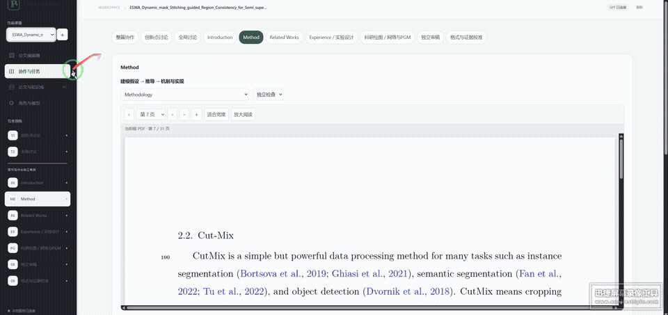
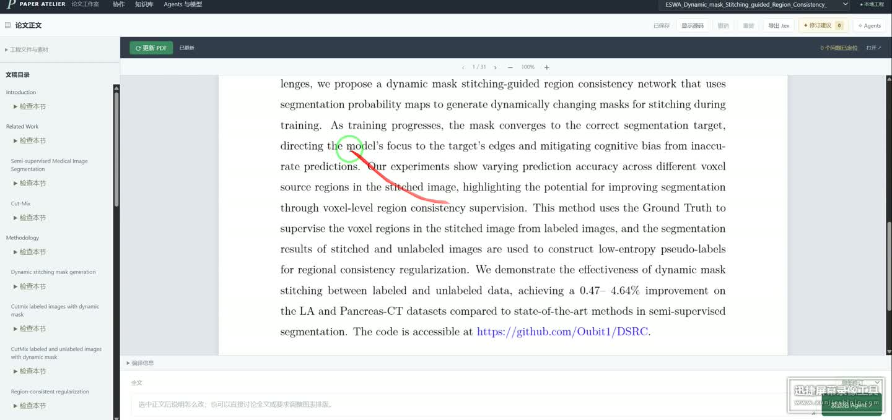
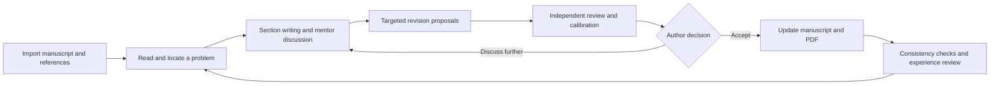

<div align="center">

# ✍️ Paper Atelier

### Turn every discussion into a precise improvement to your paper.

**Interactive PDFs · Specialist agents · Targeted revisions · Persistent writing memory**

[](https://github.com/Oubit1/paper-writing-rsi/actions/workflows/check.yml)


[简体中文](README.zh-CN.md) · **English**

[Watch it work](#watch-it-work) · [Highlights](#highlights) · [The writing loop](#the-writing-loop) · [Quick start](#quick-start) · [Writing skills](#writing-skills)

</div>

[](https://github.com/Oubit1/paper-writing-rsi/blob/main/docs/assets/workflow-demo.mp4)

<p align="center"><b>Open your paper. Select a passage. Work through the revision with an agent.</b><br>Click the preview to watch the full recording.</p>

## Why this workbench?

Revising a paper often means switching between PDFs, LaTeX, chat windows and reviewer comments. Even after a useful discussion, you still need to find the relevant passage, check its context and decide which suggestions belong in the manuscript.

Paper Atelier brings these steps into one workspace: **section writers, discussion mentors and independent reviewers work around the same current manuscript.** Start with a word, a sentence or an equation, or step back to discuss the contribution and argument of the whole paper. Discussion history, proposed edits and accepted text remain distinguishable.

## Highlights

| What you want to do | How the workbench helps |
| --- | --- |
| **📦 Start with your existing paper** | Upload a LaTeX ZIP. The workbench extracts it, identifies the main file, loads sections and assets, and compiles a PDF. Choose the entry file when there are multiple candidates. |
| **📖 Read the actual typeset manuscript** | Zoom, turn pages and select text in a compiled PDF. Section writing and review show the relevant source content, with equations and tables rendered. |
| **🎯 Fix specific problems** | Suggestions target words, phrases, sentences or complete equations, with reasons and visible differences. Accept or reject them individually, with revision history and undo/redo. |
| **🤝 Collaborate by task** | Dedicated roles cover Introduction, Method, Related Work, experiments and scientific figures. Contribution discussions, global discussions, independent review and calibration serve distinct purposes. |
| **🌐 Translate selected text** | Local INT8 models provide English–Chinese translation in both directions. Request agent refinement explicitly when needed; terminology checks and feedback support further evaluation. |
| **🧠 Carry feedback into the next revision** | Preserve project discussions, author rules and reviewed project experience. Later tasks report compliance and conflicts rather than silently losing earlier requirements. |

## Watch it work

[](docs/assets/pdf-workbench.jpg)

**[▶ Full workflow recording](https://github.com/Oubit1/paper-writing-rsi/blob/main/docs/assets/workflow-demo.mp4)**: read a section alongside its manuscript → select and translate PDF text → interact with an agent → switch collaboration tasks.

<sub>The project author supplied this recording of an actual deployment. The published version is compressed, with audio and source metadata removed. The manuscript and existing tasks illustrate the interface; a new installation starts with an empty project. The recording shows the Chinese interface.</sub>

## The writing loop



RSI here focuses on **reusing writing rules, context and reviewed experience**. An author's correction can become a constraint for later revisions. Unverified or conflicting requirements should remain explicit as the discussion grows.

| Stage | What persists |
| --- | --- |
| Discussion and section writing | Role records, manuscript context, candidate content and evidence gaps |
| Author acceptance | Actual changes, source versions and revision history |
| Independent review and calibration | Specific issues, evidence, scope and unresolved checks |
| Experience reuse | Reviewed project experience, author-rule checks and conflict explanations |

This is an iterative writing workflow, not model-weight training. Agreement among agents is not proof of a research claim or demonstrated improvement in paper quality.

## Quick start

**Windows x64 · Python 3.10–3.13 · An authenticated official Codex installation.**

```powershell
git clone https://github.com/Oubit1/paper-writing-rsi.git
cd paper-writing-rsi
.\Install.ps1
.\Start.ps1
```

Alternatively, download and extract the source ZIP, then double-click **安装依赖.cmd** (install dependencies), followed by **启动论文工作台.cmd** (start the workbench).

1. Sign in to your own Codex installation. In the workbench model settings, choose models available to your account.
2. Open the [local workbench](http://127.0.0.1:8766/) and click **上传 ZIP** (Upload ZIP) to import your paper.
3. Wait for PDF compilation, select a section or passage, and start a discussion or request a targeted revision.
4. Compare the suggestions, accept them or discuss further, then update the PDF.

Initial setup downloads dependencies, Tectonic, translation models and a pinned writing skill. The first compilation may download TeX packages. Subsequent quick translations run locally; writing and agent refinement use your own Codex login.

ZIP limits: **64 MB** uploaded, **256 MB / 500 files** extracted. Use UTF-8 TeX and include figures and bibliography assets. The importer expands `\input` / `\include`; each upload creates a separate project.

Run `.\Stop.ps1` to stop the service. For a port conflict, use `.\Start.ps1 -Port 8767`. If Codex cannot be located automatically, set `PAPER_AGENT_CODEX` to its executable path.

## Writing skills

The integrated **[MLNLP Paper-Writing-Tips](https://github.com/MLNLP-World/Paper-Writing-Tips)** skill covers mathematical notation, LaTeX, figures, tables, academic expression, citations and final checks. Section writers receive the core rules; independent reviewers and calibration roles also receive the final checklist.

Community recommendations are applied in the context of the current template, author requirements and manuscript meaning. Included text ranges and skill file hashes are recorded. When rules change, source-edit requests do not reuse results generated under the old guidance. The installer fetches a pinned upstream version and verifies SHA256 hashes; see the [integration notes (Chinese)](docs/WRITING_SKILLS.md). Maintain personal exemplars, mentor preferences and project-specific materials in your own deployment.

## References and data

Manuscripts live in `projects/`, revision and task records in `runtime/`, and reference materials in `library/`. The public repository contains source code and generic configuration. It excludes accounts, private manuscripts, runtime databases, model weights and the complete distribution archive.

Crossref keyword enrichment is disabled by default. After consenting to public-topic keyword queries, users can enable `crossref_public_topics` in `configs/library_enrichment.json` to retrieve relevant metadata and available abstracts. Writing requests include the manuscript context needed for the task; a local workbench does not mean all inference runs offline.

<details>
<summary><b>Troubleshooting</b></summary>

| Problem | Check first |
| --- | --- |
| Service does not start | Finish dependency installation, confirm the folder is writable, and inspect `runtime/server.err.log`. |
| Model unavailable | Check your Codex login and role configuration. Preset model names do not imply account access. |
| Missing translation DLL | Install the Microsoft Visual C++ x64 runtime. |
| PDF compilation fails | Read the diagnostics, check figure/style/bibliography files, and allow network access for first-time TeX package downloads. |

Do not have two machines write to the same database simultaneously. When sharing source code, avoid copying a working directory that already contains your own data and runtime records.

</details>

## Development and validation

| Directory | Responsibility |
| --- | --- |
| `app/` | Workflows, source revisions, compilation, translation and records |
| `static/` | PDF editor, collaboration interface and reference library |
| `agents/`, `configs/` | Role guidance and model/workflow configuration |
| `scripts/`, `tests/` | Component installation and isolated regression checks |

[GitHub Actions](https://github.com/Oubit1/paper-writing-rsi/actions/workflows/check.yml) checks source code, frontend scripts, ZIP imports, PDF resource snapshots and skill integration. Software tests do not replace translation-accuracy evaluation or academic assessment.

## Related projects and acknowledgments

- [CMR/LGE RSI](https://github.com/Oubit1/cmr-lge-rsi): the companion project for annotation quality control. This workbench runs independently.
- [FlashRSI](https://github.com/RUC-NLPIR/FlashRSI): an agent self-improvement experimentation framework and a reference for this page's organization.
- [Paper-Writing-Tips](https://github.com/MLNLP-World/Paper-Writing-Tips): the integrated community writing-check skill.

See [THIRD_PARTY_NOTICES.md](THIRD_PARTY_NOTICES.md) and [licenses/](licenses/) for third-party sources and licenses. This project's own code does not yet have a designated open-source license.

Reproducible bug reports and workflow suggestions are welcome through [Issues](https://github.com/Oubit1/paper-writing-rsi/issues).
